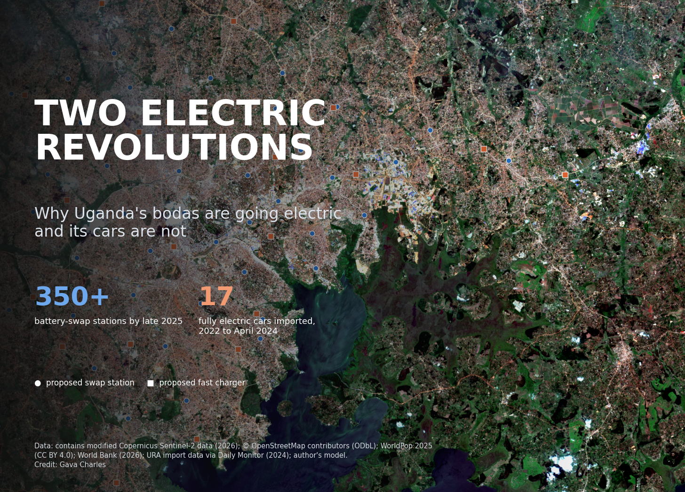
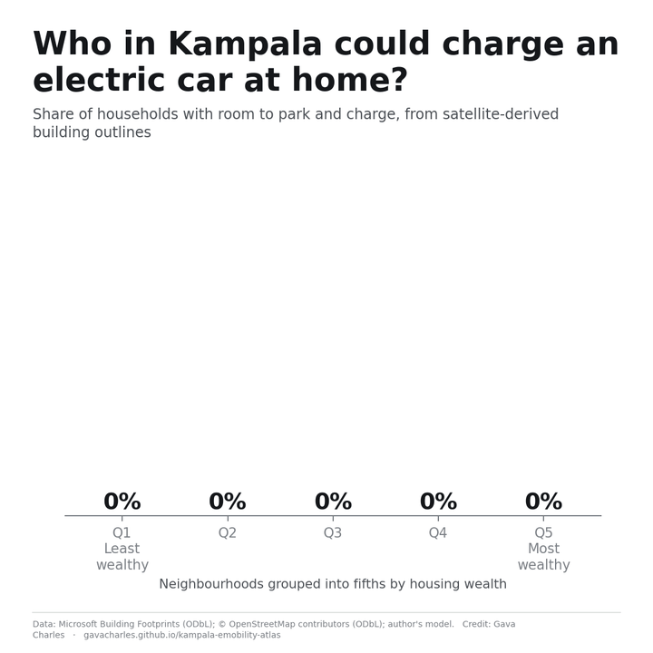
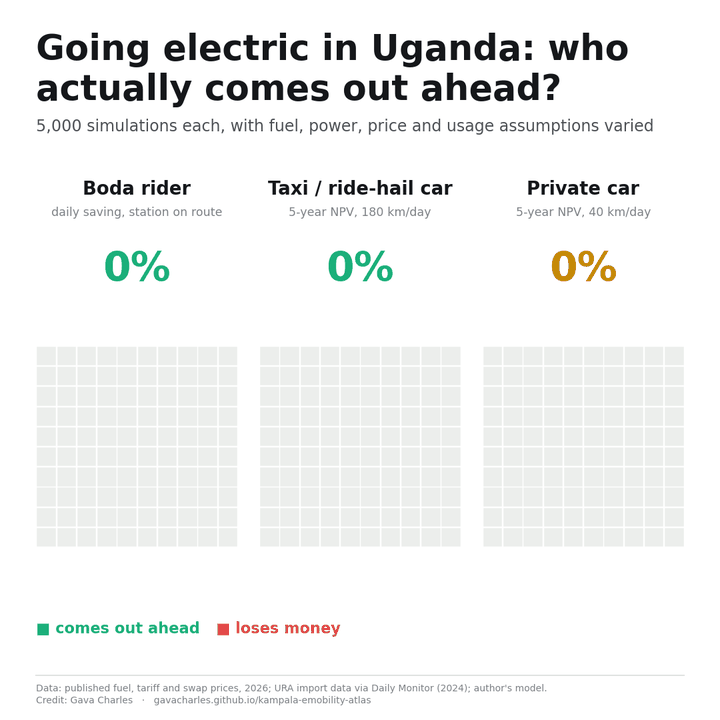
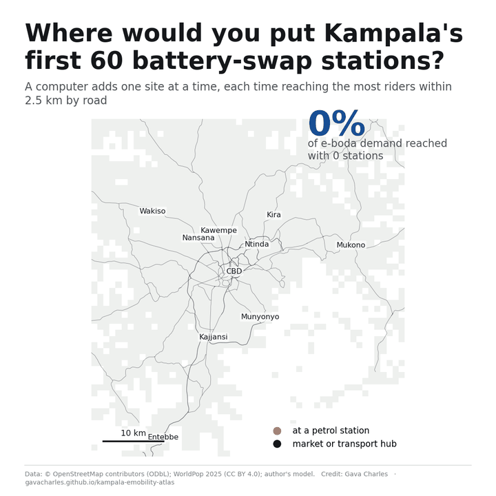
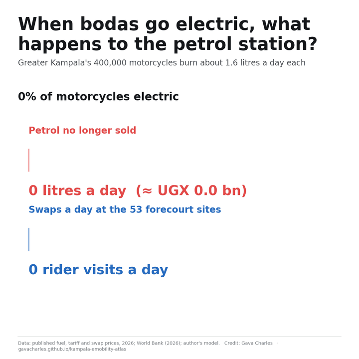
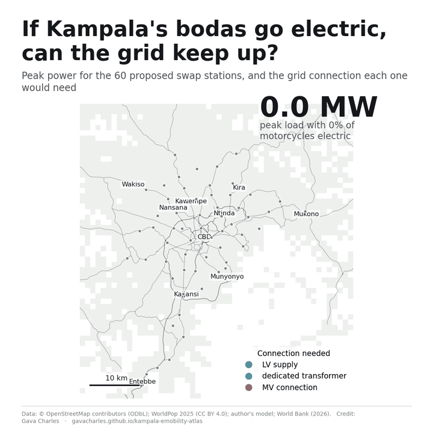
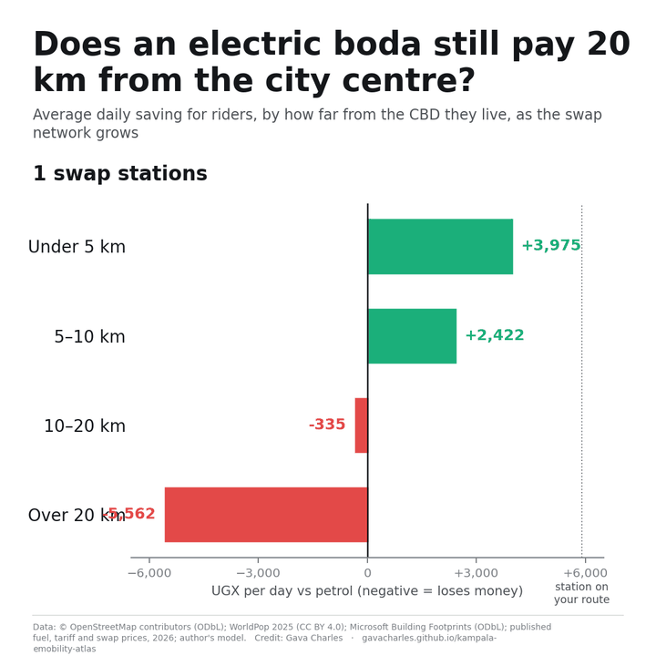

# Two electric revolutions: why Uganda's bodas are going electric and its cars are not

*Electric motorcycles and electric cars are both called EVs, but in Uganda they follow different economics, serve different people and need different infrastructure. I mapped both across Greater Kampala using only open data.*

**Interactive atlas:** https://gavacharles.github.io/kampala-emobility-atlas/
**Code and data:** https://github.com/gavacharles/kampala-emobility-atlas

---

Uganda's electric-vehicle story is really two stories.

The first is moving fast. Greater Kampala has more than 400,000 motorcycles, most of them boda-boda taxis, and they are starting to go electric. Uganda's battery-swapping network more than doubled, from about 150 stations in mid-2024 to over 350 by late 2025, according to the World Bank. Riders pull into a forecourt, hand over a flat battery, take a charged one and ride off.

The second has barely started. Uganda imported only 17 fully electric cars between 2022 and April 2024, against 910 electric motorcycles. Public fast charging in Kampala is still at the pilot stage.

Both are "EVs", so it is tempting to talk about them together. But they differ in almost every way that matters: who pays for the battery, where it gets charged, how far it is driven each day, how much tax it carries, and who can afford it. I wanted to understand those differences and what they mean for Uganda, using only data that anyone can download.

## Why bodas went first

A boda is a working vehicle. A rider covers about 65 km a day, and fuel is their biggest running cost. Those two facts do most of the work.

On my estimates, a rider with a swap station on their route saves about **UGX 5,900 a day** by going electric, at the September 2026 petrol price of about UGX 6,650 a litre. The saving held in every one of 5,000 simulations with different fuel prices, swap prices, daily distances and maintenance costs. What decides the size of the saving is how thirsty the petrol bike is, how far the rider goes each day, and the prices of petrol and of a swap.

The business model matters as much as the technology. With swapping, the rider never buys the battery, which is the most expensive part of the vehicle. They pay per swap, much as they pay per litre today. They don't wait hours to charge, which would cost fares. The operator carries the battery risk and the grid connection. That turns an expensive new technology into a familiar daily expense.

## Why cars are harder

An electric car in Kampala faces the opposite conditions.

- **The buyer pays for the battery up front.** Most cars in Uganda are used imports, and fully electric vehicles carry a 25% import duty, reinstated in 2024. I assume a used electric car costs about UGX 12 million more than a comparable petrol car.
- **Most private cars aren't driven enough to recover that.** At 40 km a day, the fuel saving is modest.
- **Charging depends on where you live.** Charging overnight at home is the cheapest option and is worth about UGX 1.6 million a year to a private owner. It needs off-street parking and your own meter. Using building outlines from satellite imagery, I estimate that about 13% of households in the least-wealthy fifth of neighbourhoods could charge at home, against about 92% in the wealthiest fifth.

The result: for a private car doing 40 km a day, switching pays off over five years in only about **52%** of simulations, a coin flip. The purchase premium matters most, followed by how fuel-hungry the petrol car it replaces is.

Taxis and ride-hail cars look like bodas. A car doing 180 km a day repays the UGX 12 million premium in about **8 months** and comes out ahead over five years in **96%** of simulations. In Uganda, the electric car's first market is the working car, not the family car.

## What I built

To see how these economics play out on the ground, I divided Greater Kampala into 3,248 one-kilometre squares and scored the 1,968 with people or activity in them, home to about 6.45 million residents. For each square I brought together:

- **Roads, shops, markets, boda stages, fuel stations and banks** from OpenStreetMap, including 15,868 km of road for measuring distances along streets, not as the crow flies.
- **Population in 2020, 2025 and 2030** from WorldPop.
- **1.2 million building outlines** from Microsoft's satellite-derived footprints, used to estimate housing wealth and who can charge a car at home.
- **A Sentinel-2 satellite image** from 29 June 2026 and a **30 m elevation model**, used to check every proposed site for slopes, flood-prone valley floors and wetlands.

## Where each one fits

The two modes want different parts of the city. Conditions for electric bodas are best in a dense band running from Bwaise and Kawempe south through Mulago, Wandegeya and Kisenyi to Katwe and Kibuye. Conditions for electric cars peak in a smaller, wealthier core: the CBD, Nakasero, Kololo and Kamwokya.

I didn't trust my own weights, so I re-ran the scoring 1,000 times with randomly shifted weights. 163 squares stayed in the top 10% for e-bodas almost every time, and 130 for e-cars. Those are the safe bets.

## The infrastructure each one needs

**For bodas: swap stations at petrol stations.** I let a computer add swap stations one at a time, each time choosing the spot that brings the most uncovered riders within 2.5 km by road. Ten stations reach 28% of e-boda demand, 30 reach 55% and 60 reach 75%. That's up to twice what random placement achieves, and within 3 percentage points of the best possible network.

**53 of the 60 best sites are petrol stations.** Restricting the network to fuel forecourts costs only about one percentage point of coverage. Forecourts sit on the main roads, already handle traffic and are staffed around the clock, so that's where a swap network naturally lands.

**For cars: a few fast chargers go a long way.** Because car demand is concentrated in a small core, **10 fast chargers reach 62% of e-car demand** within 5 km.

## So what happens to the petrol station?

If swap stations belong on forecourts, the obvious question is whether fuel retailers should want them there. Every electric boda is a customer who stops buying petrol.

On my assumptions, a boda burns about 1.6 litres a day, so Greater Kampala's 400,000 motorcycles use about 650,000 litres a day:

| Bodas gone electric | Petrol no longer sold | Worth at UGX 6,650/L |
|---|---|---|
| 10% | ~65,000 litres a day | ~UGX 0.4 billion a day |
| 25% | ~160,000 litres a day | ~UGX 1.1 billion a day |
| 50% | ~325,000 litres a day | ~UGX 2.2 billion a day |

That's the retail value, not the retailer's margin, which is a fraction of it. I don't have data on how much of a station's sales come from bodas.

Hosting the swap cabinet is how a forecourt can keep those riders. At 25% adoption, a typical forecourt site in my network would handle about 1,000 swaps a day. Riders swap almost daily and stay a few minutes, so they still buy airtime, mobile money, tyres and food. The operator pays rent or a share of revenue. And for years to come cars, trucks and minibus taxis will still run on petrol and diesel, so the pumps aren't going anywhere. Bodas are simply the first customers to leave.

There are real obstacles:

- **Power.** At 25% adoption, 21 of the 60 sites would need a medium-voltage grid connection, and someone has to pay for it.
- **Safety and space.** Charging lithium batteries next to fuel tanks needs clear separation and fire rules, and cabinets compete with pumps and parking.
- **Operators have other options.** Spiro, one of the main operators, plans to grow its large swap hubs, which charge hundreds of batteries each on their own land, from four to eleven by December 2026. If that model wins, forecourts get the smaller satellite sites, or nothing.

I found no public swap partnerships yet between Uganda's big fuel retailers and battery operators. The question for the forecourt isn't whether bodas go electric. It's whether the forecourt hosts the swap or loses the rider to someone who does.

## The grid is the real bottleneck

The two modes put different loads on the grid. Bodas mean many small batteries charged all day at a few busy sites. If a quarter of Kampala's motorcycles went electric, the 60 swap stations would handle about 72,000 swaps a day and need around 17.5 MW at peak. Twenty-one of them would need a medium-voltage connection, not just a transformer.

Cars are smaller in total for now but heavier per site. A fleet of 2,000 electric taxis using the 30 proposed fast-charging sites would need about 5.9 MW, and three sites would need medium-voltage connections.

For comparison, the World Bank projects that electric vehicles could add 60 to 99 MW to Uganda's peak demand, depending on how well charging is managed. Building a network within reach of most people is one problem. Supplying it with enough power is another.

## Distance decides who benefits

The UGX 5,900 a day assumes a station on the rider's route. Riders who have to detour to swap lose time and fares. Measured from where people live:

- With **10** stations, the average rider saves about **UGX 2,000** a day.
- With **30**, about **UGX 3,850**.
- With **60**, about **UGX 4,500**.

At the edge of the city it's starker. More than 20 km from the centre, a rider would **lose** about UGX 3,550 a day with only 10 stations, because of the trips to swap. With 60 stations, they gain about UGX 2,200. And more than 10 km from the centre is where 55% of new residents are settling.

## Who gets left out?

Here the two modes split again.

In rich countries, charging stations tend to cluster in wealthy areas. In Kampala, the swap network does the opposite: it reaches the least-wealthy fifth of residents better (54% covered) than the wealthiest (33%), because that's where boda demand is. The real divide for bodas is geographic. Within 5 km of the centre, 93% of people are covered by 30 swap stations. Beyond 20 km, 11%.

For private cars, the divide is wealth. Public chargers can be placed fairly, but the cheapest way to run an electric car, charging at home, is mostly available to households that are already well off.

## What this means for Uganda

- **Treat bodas and cars as separate policies.** Bodas already pay their way where stations exist. The task is reach. Cars don't yet pay their way for most private owners. The task is cost.
- **Operators:** start at the inner-city forecourts, then densify outwards in clusters. A single station in a peri-urban area doesn't leave riders better off.
- **Fuel retailers:** the boda litres will go either way. Hosting swaps keeps the rider on your forecourt.
- **Utilities and planners:** expect clustered medium-voltage requests along a handful of corridors as adoption grows, from swap stations first and fast chargers later.
- **Policymakers:** support peri-urban swap stations, where commercial networks arrive last. Target any car incentives, including import-duty relief, at taxi and ride-hail fleets first, where each electric car displaces the most petrol.

## What this can't tell you

This is built from public data, not operator records. Scores show where conditions are favourable, not where people have already switched. Several cost inputs are assumptions and are labelled as such, and fuel prices have kept moving since I fixed them. Only three charging or swap stations are mapped in OpenStreetMap, so I designed the networks from scratch rather than auditing the real ones. If you run a swap network, import or finance vehicles, or work at a utility and want to test these results against real data, I'd like to hear from you.

Everything is open: the code, the maps and the data are on GitHub, and you can explore the interactive atlas, play the network build-out and test your own fuel and swap prices.

*Two research papers based on this work are in preparation.*
