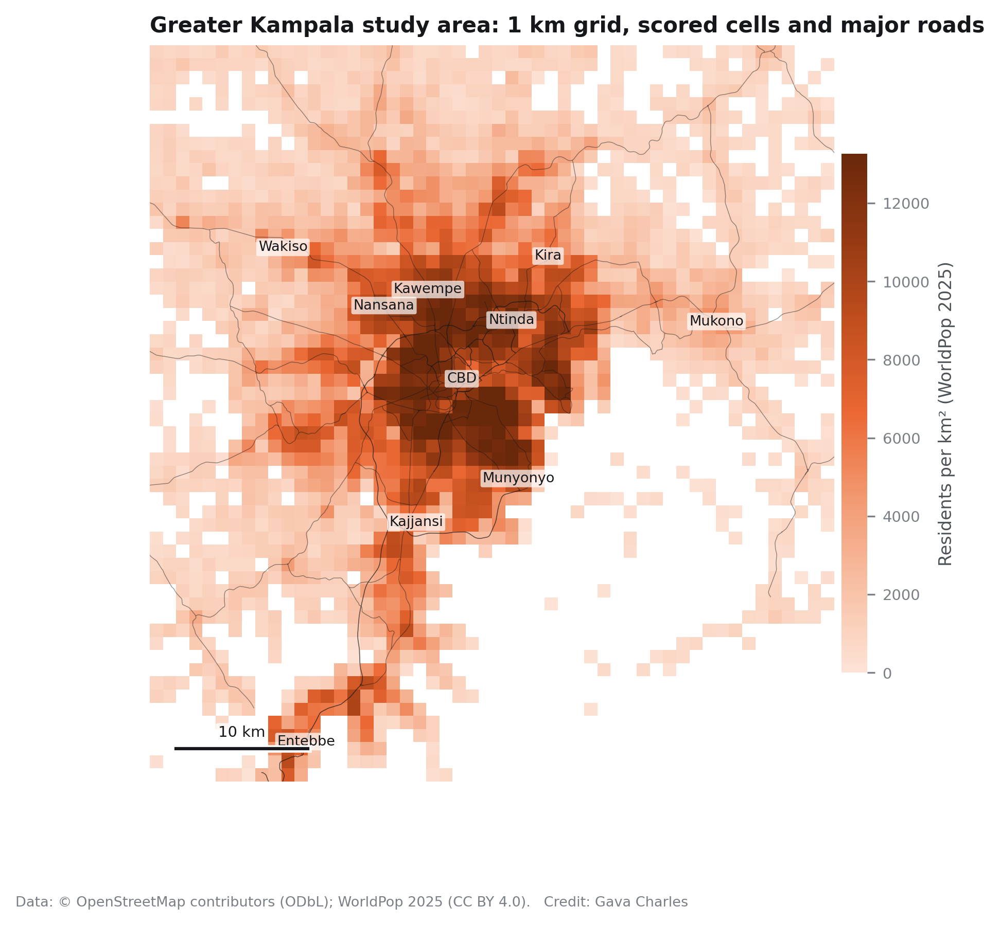
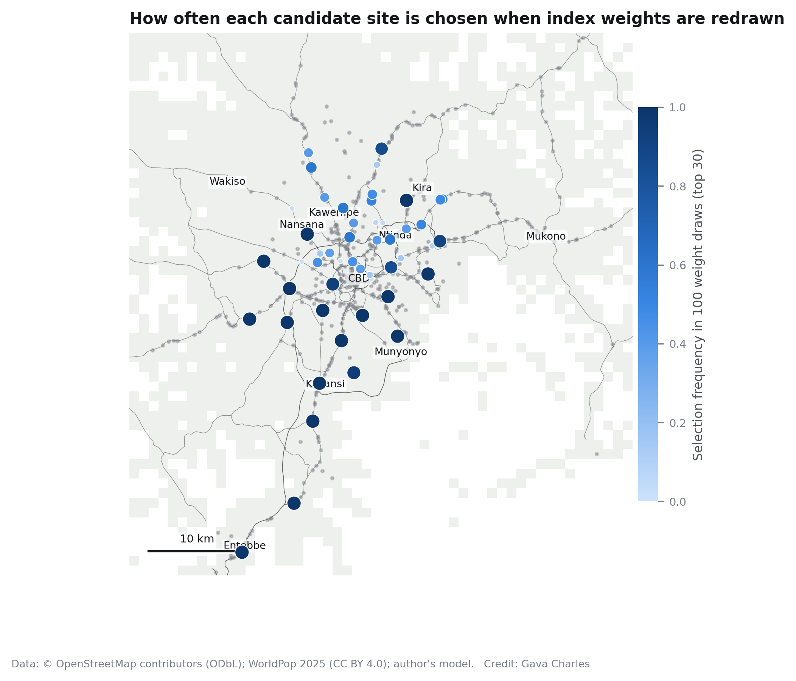

# Where to swap and where to charge: an open-data, road-network framework for siting electric motorcycle-taxi battery swapping and electric-car fast charging in Greater Kampala

**Charles Gava**
[Affiliation to be added] · gavacharles85@gmail.com

## Highlights

- An open-data, reproducible framework sites e-boda swap stations and e-car fast chargers together for a city of 6.4 million.
- Greedy siting on a 15,868 km road graph comes within 1.3–3.0 percentage points of exact MCLP optima solved by HiGHS.
- Fuel forecourts alone can host a swap network at a cost of about one percentage point of coverage.
- A 60-site coverage plan needs medium-voltage connections at 21 sites once 25% of motorcycles are electric.
- Both networks reach the least-wealthy built-up areas more than the wealthiest; the urban fringe is left behind.

## Abstract

Electric motorcycle taxis (*boda-bodas*) are electrifying quickly in East Africa through battery swapping, while electric cars remain at the earliest stage of adoption. Planning infrastructure for both is constrained by a lack of operator data. This paper develops an open-data, road-network framework that maps adoption suitability for electric bodas and electric cars, sites battery-swap stations and DC fast chargers, and screens every proposed site for terrain, flood exposure and grid connection needs. It is applied to Greater Kampala, Uganda, on a 1 km grid of 1,968 populated cells (6.45 million residents) using OpenStreetMap, WorldPop, Microsoft building footprints, Sentinel-2 imagery and the Copernicus 30 m elevation model. Suitability indices are weighted percentile ranks whose robustness is tested with 1,000 Dirichlet weight redraws; both are strongly clustered (Moran's *I* = 0.82 and 0.66) and track satellite-measured built-up surface (Spearman ρ = 0.70 for e-bodas). A greedy maximal covering location model on a 652,196-node road graph reaches 27.9%, 54.9% and 74.6% of e-boda demand within 2.5 km by road with 10, 30 and 60 swap sites, within 1.3–2.7 percentage points of exact optima and 1.5–1.9 times the coverage of random placement. Ten fast-charging sites reach 62.4% of e-car demand within 5 km. Fuel forecourts alone sustain almost the same swap coverage. Both networks are mildly pro-poor across wealth quintiles (concentration indices −0.06 and −0.08) but leave the outer and peri-urban rings, which absorbed 55% of new residents in 2020–25, largely unserved. Operational sizing shows that coverage-optimal networks become capacity-constrained quickly: at 25% fleet electrification, 21 of 60 swap sites would need medium-voltage connections. The framework is released as open code and an interactive atlas.

**Keywords:** electric motorcycle taxis; battery swapping; EV charging; maximal covering location problem; open data; remote sensing; Kampala

---

## 1. Introduction

Motorcycle taxis, known as *boda-bodas* in Uganda and Kenya, are the backbone of urban mobility in many East African cities. Greater Kampala alone has over 400,000 motorcycles, more than 60% of Uganda's registered vehicle fleet (World Bank, 2026). Their electrification is moving faster than that of any other vehicle class: Uganda's battery-swap network grew from about 150 stations in mid-2024 to more than 350 by late 2025 (World Bank, 2026), led by operators such as Spiro, Zembo and Gogo. Electric cars, in contrast, are barely present: Uganda imported only 17 fully electric cars between 2022 and April 2024, against 910 electric motorcycles (Uganda Revenue Authority, reported by The Observer, 2024), and public fast charging is at the pilot stage: the Ministry of Energy opened a station at Amber House in Kampala in 2025 with about nine more planned, and TotalEnergies has opened another on Wampewo Avenue. A national plan targets 3,500 public charging stations by 2040.

Infrastructure for both modes is being sited now, largely by operators using proprietary data. Public agencies, financiers and new entrants have little independent evidence on where demand is likely, where networks should go, and who they will serve. The academic literature on e-motorcycle-taxi electrification in the region has focused on emissions (Vanatta et al., 2022), techno-economics (La Fleur et al., 2024), policy and market trends (Martin et al., 2023) and, most recently, a grid-aware, GPS-based techno-economic rollout for Kampala (Kimuli et al., 2026). The latter uses proprietary GPS duty cycles and feeder power-flow simulation; it does not address electric cars, equity of access, robustness of siting to modelling choices, or how far open data alone can take the planning problem.

This paper asks three questions:

1. **Where** in Greater Kampala are conditions most suitable for electric boda and electric car adoption, and how robust is that picture to the weights an analyst chooses?
2. **Where should** battery-swap stations and fast chargers go, how close is a simple, transparent siting heuristic to the optimum, and what do the resulting networks need from the terrain and the grid?
3. **Who** do these networks reach, across wealth and across the city's core-to-periphery gradient?

The contributions are fourfold. First, a fully reproducible, open-data pipeline that treats both modes on the same grid and road graph, which lets their infrastructure needs and distributional effects be compared directly. Second, an evaluation of greedy maximal-coverage siting against exact mixed-integer optima, random placement and a fuel-forecourt-only candidate pool, plus a test of siting robustness to the suitability weights. Third, an engineering screen of every proposed site using satellite imagery, a 30 m DEM, mapped wetlands and load-based grid connection classes. Fourth, an equity analysis showing which places each network reaches. All code, derived data and an interactive atlas are public.

## 2. Background and related work

### 2.1 Electrifying motorcycle taxis in East Africa

Motorcycle taxis grew across African cities as a demand-responsive, informal mode filling gaps left by formal public transport (Kumar, 2011). Their electrification is attractive because riders cover long daily distances with low-cost fuel-inefficient engines, so operating savings are large. Vanatta et al. (2022) estimated the emissions impacts of electrifying Kampala's motorcycle taxis. La Fleur et al. (2024) showed for Kenya that electric motorcycles are cheaper over their use phase despite higher upfront costs, and that financing raises total costs through daily payments. Martin et al. (2023) reviewed digitalisation and electrification trends across East African capitals. Kimuli et al. (2026) combined GPS-derived duty cycles, hub optimisation and feeder-level power-flow simulation for Kampala, finding that hybrid swap–charge configurations cut ownership costs by 18–27% while keeping feeder utilisation below 85% of design capacity. The present paper is complementary: it relies only on open data, adds electric cars, and focuses on robustness, site screening and equity.

### 2.2 Locating charging and swapping infrastructure

Facility location for alternative-fuel vehicles builds on the maximal covering location problem (MCLP; Church and ReVelle, 1974), the p-median problem (Hakimi, 1964) and flow-based models that intercept trips rather than serve places (Hodgson, 1990; Kuby and Lim, 2005). For two-wheelers, Feng and Lu (2022) combined machine-learning demand estimation with swap-station deployment, and Uribe et al. (2023) sized swap stations for hybrid and electric motorcycles with discrete-event simulation. GIS multi-criteria methods dominate the applied charging-station literature (Banegas and Mamkhezri, 2021). Greedy selection is widely used in practice because it yields a build order; for coverage objectives it carries a (1 − 1/e) approximation guarantee (Nemhauser et al., 1978). How close it comes on real urban road networks, and how stable its choices are to modelling assumptions, is rarely reported.

### 2.3 Open data and remote sensing as proxies

Where surveys and administrative data are scarce, satellite imagery and derived products have been used to predict wealth (Jean et al., 2016; Yeh et al., 2020). Gridded population models such as WorldPop (Tatem, 2017) and machine-learned building footprints now cover all of Africa. OpenStreetMap (Haklay and Weber, 2008) provides roads and points of interest, though its completeness varies with mapping effort. Equity analyses of charging access in high-income settings consistently find that lower-income areas are less well served (Carlton and Sultana, 2024; Jiao et al., 2024). Whether this holds for swap networks in an African city, where demand is densest in lower-income areas, is an open question.

## 3. Study area and data

Greater Kampala sits on the northern shore of Lake Victoria on a terrain of flat-topped hills (up to 1,341 m) separated by papyrus valleys close to the lake level (1,083 m). The study area is the envelope 0.03–0.55°N, 32.35–32.85°E, covering Kampala and the urbanised parts of Wakiso and Mukono districts and Entebbe (Figure 1). It is divided into a 1 km grid in UTM zone 36N (3,248 cells). A cell is scored if it contains mapped activity or a major road, or at least 500 residents per km²; 1,968 cells qualify, holding 6.45 million residents in 2025.

**Table 1. Data sources.**

| Layer | Source | Use |
|---|---|---|
| Roads (all drivable classes), 15,868 km | OpenStreetMap via Overpass, October 2026 | Routing graph, major-road density |
| Points of interest: 6,312 shops, 2,194 education, 1,786 parking, 1,250 food and drink, 1,188 offices, 1,136 health, 945 banks/ATMs, 524 fuel stations, 313 car trade, 155 transport hubs, 137 markets | OpenStreetMap | Trip generators, candidate sites |
| Existing EV/swap stations (3 mapped) | OpenStreetMap | Not used for siting (greenfield) |
| Population 2020, 2025, 2030 (100 m) | WorldPop Global2 R2025A constrained | Density, growth, demand weights |
| 1.20 million building footprints | Microsoft Global ML Building Footprints, 2026-02 | Housing wealth and home-charging proxies |
| Sentinel-2 L2A, 29 June 2026, 1.1% cloud | Copernicus via Element 84 Earth Search | True colour, NDVI, NDBI, MNDWI |
| Elevation, 30 m | Copernicus DEM GLO-30 | Slope, hillshade, valley-floor flood screen |
| Power lines (4,937), substations (42), transformers (234); 5,288 wetland polygons | OpenStreetMap | Site screening |

## 4. Methods

### 4.1 Features

For each cell the pipeline counts points of interest by category, sums major-road length, and computes a centrality score that averages the percentile rank of proximity to the central business district with that of activity in the surrounding 5 × 5 cells. Population and growth come from summing WorldPop pixels whose centres fall in the cell.

Two proxies come from building footprints. The **housing wealth proxy** combines open space per building (60%) with median residential footprint (40%), computed only for built-up cells (≥ 200 buildings per km²). Footprint size alone failed a face-validity check: the footprint model merges adjoining roofs in dense informal settlements, so Kisenyi and Katanga scored like Kololo. Open space per building separates known affluent neighbourhoods (Kololo 1,717 m², Bugolobi 1,891 m², Naguru 2,442 m²) from dense low-income ones (Bwaise 545 m², Kawempe 239 m², Namuwongo 560 m²). The **home-charging potential** maps open space per building linearly from 0 (≤ 300 m²) to 1 (≥ 2,000 m²) as the share of households likely to have off-street parking and their own meter. Because both proxies use the same measure, their association is partly built in, and we do not interpret it as independent evidence.

### 4.2 Suitability indices and their robustness

Each index is a weighted sum of within-study-area percentile ranks (Table 2). Weights are expert priors, not fitted parameters, because no adoption labels exist at this scale. Following Saisana et al. (2005), we treat the weights as uncertain: each index is recomputed under 1,000 weight vectors drawn from a Dirichlet distribution centred on the base weights (concentration 40, about ±0.05 on a weight of 0.15), and we record how often each cell falls in the top 10%.

**Table 2. Index weights.**

| Feature | E-boda | E-car |
|---|---|---|
| Population density, 2025 | 0.20 | 0.05 |
| Trip generators (shops, markets, food, education, health) | 0.20 | – |
| Major-road km | 0.15 | 0.15 |
| Population growth 2020–25 | 0.15 | 0.10 |
| Transport hubs | 0.10 | – |
| Fuel stations | 0.10 | 0.05 |
| Centrality | 0.10 | 0.10 |
| Housing wealth proxy | – | 0.25 |
| Affluence POIs (banks, offices, food and drink) | – | 0.15 |
| Car trade, parking | – | 0.10 each |

### 4.3 Spatial structure

Global Moran's *I* (Moran, 1950) with queen contiguity is tested with 999 permutations. Local hot and cold spots use the Getis–Ord Gi\* statistic (Ord and Getis, 1995) with the Benjamini–Hochberg false discovery rate at 5% (Benjamini and Hochberg, 1995). As an external check that does not enter the indices, we correlate each index with cell-mean Sentinel-2 indices: NDBI for built-up surface (Zha et al., 2003), NDVI for vegetation (Tucker, 1979) and MNDWI for water (Xu, 2006).

### 4.4 Road network and siting

All drivable OSM ways (motorway to residential, service and track) form an undirected graph of 652,196 nodes and 670,072 edges; the largest connected component is retained. Cell centroids and candidate sites are snapped to the nearest node, and distances are shortest paths plus snap offsets.

Demand for e-boda swapping in cell *i* is *wi* = populationi × e-boda indexi/100, and analogously for e-cars. Candidate swap hosts are fuel stations, markets and transport hubs (557 after merging candidates within 250 m); candidate fast-charging hosts are fuel stations, car parks and car dealers (1,156). Coverage radii are 2.5 km by road for swapping, which riders reach between fares, and 5 km for fast charging, which serves ride-hail fleets and households without home charging. Sensitivity runs use 1.5/3.5 km and 3/8 km.

Sites are selected greedily, each time adding the candidate that covers the most uncovered demand, up to 60 swap and 30 charging sites. This gives an ordered build plan. We benchmark it three ways: (i) the exact MCLP optimum for *N* = 10, 30, 60 (swap) and 5, 10, 20 (charging), solved as a mixed-integer program with HiGHS (Huangfu and Hall, 2018) to a relative gap ≤ 10⁻⁴; (ii) 200 random *N*-site networks; (iii) greedy selection restricted to fuel stations. To test robustness to the suitability weights, the greedy swap network of 30 sites is recomputed under 100 Dirichlet weight draws, and we report Jaccard overlap with the base network and how often each candidate is selected.

### 4.5 Site screening and operational sizing

Each proposed site is screened for **slope** (≤ 8° for forecourt and cabinet works), **flood exposure** (≥ 3 m above the lowest point within 1.5 km, a height-above-drainage proxy after Nobre et al., 2011, and outside mapped wetland or water) and **grid connection**. OSM maps only part of the distribution network (the median swap site is 793 m from a mapped line, though all are on electrified urban roads), so grid needs are graded by load: ≤ 50 kW low-voltage supply, ≤ 315 kW dedicated transformer, otherwise a medium-voltage connection.

Every populated cell is assigned to its nearest proposed site by road. Greater Kampala's 400,000 motorcycles are allocated to cells in proportion to e-boda demand. Under 10%, 25% and 50% electrification, each rider makes 0.72 swaps per day (65 km per day over 90 km per pack); a swap draws 2.9 kWh at 90% charger efficiency; an eight-slot cabinet handles 64 swaps per day; and peak grid load is daily energy over 20 charging hours × 1.5. For fast charging, scenario fleets of 500, 2,000 and 5,000 electric ride-hail cars charge 70% of 180 km per day in public at 0.17 kWh/km, on 60 kW ports at 35% utilisation. These are scenario assumptions and are reported as such.

### 4.6 Equity

Coverage and access are summarised by housing-wealth quintile (built-up cells) and by distance ring from the CBD (< 5, 5–10, 10–20, > 20 km). Inequality in coverage across the wealth ranking is measured with the concentration index (Wagstaff et al., 1991), where negative values mean coverage concentrates in less-wealthy areas.

## 5. Results

### 5.1 Suitability is concentrated and robust at the top

Both indices are strongly spatially clustered: Moran's *I* is 0.82 for e-boda suitability and 0.66 for e-car suitability (both *p* = 0.001; Figure 2). After FDR control, Gi\* identifies 392 e-boda hot-spot cells and 263 e-car hot-spot cells (Figure 3). The most suitable e-boda cells form a contiguous band running from Bwaise and Kawempe south through Mulago, Wandegeya and Kisenyi to Katwe and Kibuye; e-car suitability peaks in the CBD, Nakasero, Kololo and Kamwokya. The two indices are correlated (Spearman ρ = 0.82) but diverge at the margins, where e-car suitability follows housing wealth and e-boda suitability follows density.

Under 1,000 weight redraws, 163 cells stay in the e-boda top decile in at least 90% of draws, and 130 do so for e-cars. Population growth, measured as residents added per km², is the most clustered layer of all (*I* = 0.97; 311 hot-spot cells, none cold). Its hot spots are dense inner neighbourhoods such as Kasubi–Kawaala and Katwe–Kibuye. Growth *rates* are similar in every ring (15–16% over 2020–25), so in absolute terms most new residents (55%) are added 10 km or more from the centre, where most people already live.

Independent satellite measures agree with the indices: e-boda suitability rises with built-up surface (ρNDBI = 0.70) and falls with vegetation (ρNDVI = −0.75); e-car suitability also rises with NDBI (ρ = 0.53).

### 5.2 The swap network

The greedy swap network covers 27.9% of e-boda demand with 10 sites, 54.9% with 30 and 74.6% with 60 (Figure 5, Table 3). The first sites sit at the busiest fuel stations and boda stages of the inner city: a petrol station on the Kisenyi–Mengo edge, then sites in Bwaise–Kawempe, Makindye and Kabalagala, and Shell Ntinda. Exact optima are 29.2%, 57.6% and 76.7%, so the greedy plan gives up 1.3–2.7 percentage points for the benefit of a build order. Random placement achieves only 14.4%, 33.0% and 48.8%. Restricting candidates to fuel stations costs about one percentage point (27.2%, 53.6%, 73.5%), and 53 of the 60 greedy sites are in fact fuel stations. Coverage is highly sensitive to the reach assumed: 30 sites cover 31.2% of demand at 1.5 km, 54.9% at 2.5 km and 77.0% at 3.5 km.

The siting is robust to the suitability weights. Across 100 weight redraws, the 30-site network overlaps the base network with a mean Jaccard index of 0.76 (5th percentile 0.50); 21 of the base 30 sites are chosen in at least 80% of draws; and the redrawn networks lose no coverage on the base demand (mean +0.4 points, within the greedy approximation error; Figure 6).

**Table 3. Coverage of demand by network size.**

| Network | Sites | Greedy | Exact optimum | Random (mean) | Fuel stations only |
|---|---|---|---|---|---|
| E-boda swap, 2.5 km | 10 | 27.9% | 29.2% | 14.4% | 27.2% |
| | 30 | 54.9% | 57.6% | 33.0% | 53.6% |
| | 60 | 74.6% | 76.7% | 48.8% | 73.5% |
| E-car fast charging, 5 km | 5 | 43.6% | 45.8% | 25.9% | – |
| | 10 | 62.4% | 64.2% | 39.3% | – |
| | 20 | 81.4% | 84.4% | 55.3% | – |

### 5.3 The fast-charging network

Because e-car demand is concentrated in the affluent inner city, a small charging network goes far: 5 sites reach 43.6% of e-car demand within 5 km by road and 10 sites reach 62.4% (exact optimum 64.2%), covering 55.6% of residents (Figure 11). The first site is a car park at the western edge of the CBD, followed by forecourts in Ntinda, Kawempe, on Salaama Road and in Najjanankumbi; 21 of the 30 sites are fuel stations and 9 are car parks. Coverage depends on the reach assumed even more than for swapping: 10 sites cover 36.3% of demand at 3 km and 85.5% at 8 km.

### 5.4 Site screening: terrain, flood and grid

Satellite imagery confirms that proposed sites sit on built-up road frontages (gis01, gis02). None falls in a mapped wetland or within 3 m of its local valley floor (gis05), unsurprising given that forecourts are on raised roads, but an important check in a city whose valley floors flood seasonally. Five of the 60 swap sites lie on slopes steeper than 8° and would need civil works (gis04). All 30 charging sites pass both checks.

The grid is the binding constraint (Table 4, gis06). At 10% motorcycle electrification the network handles about 28,900 swaps a day, needs 480 cabinets and draws about 7.0 MW at peak, and 56 of 60 sites need a dedicated distribution transformer. At 25% electrification, throughput reaches 72,200 swaps a day, 1,158 cabinets and 17.5 MW, and 21 sites exceed what a single transformer can supply; the busiest site would handle about 2,480 swaps a day. At 50%, 53 sites need medium-voltage connections. A charging network for 2,000 electric ride-hail cars needs 98 fast-charging ports and about 5.9 MW.

**Table 4. Operational sizing of the 60-site swap network.**

| Motorcycles electric | Swaps per day | Cabinets | Peak grid load | Sites needing MV connection |
|---|---|---|---|---|
| 10% (40,000) | 28,888 | 480 | 7.0 MW | 0 |
| 25% (100,000) | 72,217 | 1,158 | 17.5 MW | 21 |
| 50% (200,000) | 144,431 | 2,287 | 34.9 MW | 53 |

### 5.5 Who the networks reach

Contrary to the pattern in high-income settings, both networks reach less-wealthy areas more than wealthier ones (Figure 14). At 30 swap sites, 54% of residents in the least-wealthy quintile are within 2.5 km by road, against 33% in the wealthiest; the concentration index is −0.06. At 10 charging sites, 71% of the least-wealthy quintile and 53% of the wealthiest are covered (−0.08). E-car suitability itself is pro-rich (+0.06), so the charging network serves dense areas where e-car demand is modest as well as affluent ones.

The core–periphery gradient is far steeper. At 30 swap sites, coverage is 93% within 5 km of the CBD, 70% at 5–10 km, 24% at 10–20 km and 11% beyond 20 km. At 10 charging sites, it is 99%, 91%, 36% and 0%. The outer and peri-urban rings hold 3.5 million people and absorbed 55% of the population added in 2020–25 (WorldPop).

## 6. Discussion

**Open data go a long way, and know their limits.** With no operator inputs, the framework reproduces patterns operators already act on: the first sites fall on the busiest forecourts and boda stages of the inner city, and the network is dominated by fuel stations, consistent with announced partnerships between swap operators and forecourt chains, such as TotalEnergies' automated swap station with Zembo (New Vision, n.d.). The satellite agreement and the stability of siting under weight perturbation suggest the results are not artefacts of analyst choices. They remain suitability, not observed demand.

**Greedy is good enough, and gives a build order.** On a large real road network, greedy selection lands within 3 points of the exact optimum while giving an ordered plan, which is what a capital-constrained operator needs. The exact model is cheap enough (seconds with HiGHS) to serve as a routine check.

**Coverage and capacity are different problems.** A network designed to put a station within reach of most demand concentrates very large loads on a few inner-city sites once adoption grows. The 17.5 MW at 25% electrification sits within the 60–99 MW peak range the World Bank (2026) projects for electric vehicles in Uganda, and is similar in scale to the feeder constraints Kimuli et al. (2026) model. Two implications follow: inner-city networks must densify well beyond what coverage alone suggests (consistent with the hundreds of stations already operating), and grid planners should expect clustered medium-voltage requests along a handful of corridors.

**Who gets served depends on geography more than income.** Swap demand is densest where incomes are lowest, so even a demand-maximising network is mildly pro-poor across the city. The real exclusion is spatial: residents more than 10 km from the centre are barely reached by either network, yet these rings absorb most new residents. Without deliberate peri-urban siting or subsidy, electrification will lag where most of the city's population growth is landing.

## 7. Limitations

Suitability weights are priors; robustness analysis bounds but does not replace calibration against observed adoption. OSM completeness varies, which affects POI-based features; the population criterion for scoring mitigates this. Wealth and home-charging proxies share a footprint measure and misread 1 km cells that mix estates with hospitals or airstrips. The road graph measures distance, not travel time or congestion. Grid screening uses loads rather than real feeder capacity, and operational parameters are scenario assumptions. Existing stations were not used because only three are mapped; the framework supports seeding with an inventory when one is available.

## 8. Conclusion

An open-data, road-network framework can identify where electric bodas and electric cars are most likely to take hold, propose ordered and near-optimal swap and charging networks, screen sites for terrain, flood and grid needs, and show who those networks serve. In Greater Kampala, inner-city forecourts are the natural backbone of both networks, greedy plans are within a few points of optimal, and the main risks are grid capacity at the busiest sites and the exclusion of the periphery, where most new residents are arriving. The code, data and an interactive atlas are openly available to support operators, utilities and city planners.

## Data and code availability

All code, derived data, figures and the interactive atlas are available at https://github.com/gavacharles/kampala-emobility-atlas (MIT licence for code; derived data under ODbL where derived from OpenStreetMap or Microsoft footprints). The atlas is at https://gavacharles.github.io/kampala-emobility-atlas/.

## CRediT authorship contribution statement

Charles Gava: Conceptualization, Methodology, Software, Formal analysis, Visualization, Writing – original draft, Writing – review & editing.

## Declaration of competing interest

The author declares no competing interests.

## Funding

[To be completed.]

## References

Banegas, J., Mamkhezri, J., 2021. A systematic review of geographic information systems based methods and criteria used for electric vehicle charging station site selection. SSRN Electronic Journal. https://doi.org/10.2139/ssrn.4130761

Benjamini, Y., Hochberg, Y., 1995. Controlling the false discovery rate: a practical and powerful approach to multiple testing. Journal of the Royal Statistical Society Series B 57(1), 289–300. https://doi.org/10.1111/j.2517-6161.1995.tb02031.x

Carlton, G.J., Sultana, S., 2024. Electric vehicle charging equity and accessibility: a comprehensive United States policy analysis. Transportation Research Part D 129, 104123. https://doi.org/10.1016/j.trd.2024.104123

Church, R., ReVelle, C., 1974. The maximal covering location problem. Papers of the Regional Science Association 32(1), 101–118. https://doi.org/10.1007/BF01942293

Feng, Y., Lu, X., 2022. Deployment and operation of battery swapping stations for electric two-wheelers based on machine learning. Journal of Advanced Transportation 2022, 8351412. https://doi.org/10.1155/2022/8351412

Haklay, M., Weber, P., 2008. OpenStreetMap: user-generated street maps. IEEE Pervasive Computing 7(4), 12–18. https://doi.org/10.1109/MPRV.2008.80

Hakimi, S.L., 1964. Optimum locations of switching centers and the absolute centers and medians of a graph. Operations Research 12(3), 450–459. https://doi.org/10.1287/opre.12.3.450

Hodgson, M.J., 1990. A flow-capturing location-allocation model. Geographical Analysis 22(3), 270–279. https://doi.org/10.1111/j.1538-4632.1990.tb00210.x

Huangfu, Q., Hall, J.A.J., 2018. Parallelizing the dual revised simplex method. Mathematical Programming Computation 10, 119–142. https://doi.org/10.1007/s12532-017-0130-5

Jean, N., Burke, M., Xie, M., Davis, W.M., Lobell, D.B., Ermon, S., 2016. Combining satellite imagery and machine learning to predict poverty. Science 353(6301), 790–794. https://doi.org/10.1126/science.aaf7894

Jiao, J., Choi, S.J., Nguyen, C., 2024. Toward an equitable transportation electrification plan: measuring public electric vehicle charging station access disparities in Austin, Texas. PLOS ONE 19(9), e0309302. https://doi.org/10.1371/journal.pone.0309302

Kimuli, I., Kirabira, J.B., Nakyejwe, S.L.K., 2026. Electrifying boda-boda transportation with battery-swapping: a techno-economic and grid-aware rollout for Kampala Metropolis. Energy Conversion and Management: X 30, 101648. https://doi.org/10.1016/j.ecmx.2026.101648

Kuby, M., Lim, S., 2005. The flow-refueling location problem for alternative-fuel vehicles. Socio-Economic Planning Sciences 39(2), 125–145. https://doi.org/10.1016/j.seps.2004.03.001

Kumar, A., 2011. Understanding the emerging role of motorcycles in African cities: a political economy perspective. SSATP Discussion Paper 13. World Bank, Washington, DC. https://doi.org/10.1596/17804

La Fleur, L., Lindkvist, E., Trångteg, R., Winter, S., Thollander, P., 2024. Riding the future: environmental, primary energy and economic analysis of an electric motorcycle – a Kenyan case study. Energy for Sustainable Development 83, 101573. https://doi.org/10.1016/j.esd.2024.101573

Martin, E., Courtright, T., Nkurunziza, A., Lah, O., 2023. Motorcycle taxis in transition? Review of digitalization and electrification trends in selected East African capital cities. Case Studies on Transport Policy 13, 101057. https://doi.org/10.1016/j.cstp.2023.101057

New Vision, n.d. TotalEnergies, Zembo unveil automated battery swapping station. https://newvision.co.ug/category/business/totalenergies-zembo-unveil-automated-battery-NV_217921

Moran, P.A.P., 1950. Notes on continuous stochastic phenomena. Biometrika 37(1/2), 17–23. https://doi.org/10.2307/2332142

Nemhauser, G.L., Wolsey, L.A., Fisher, M.L., 1978. An analysis of approximations for maximizing submodular set functions—I. Mathematical Programming 14, 265–294. https://doi.org/10.1007/BF01588971

Nobre, A.D., Cuartas, L.A., Hodnett, M., Rennó, C.D., Rodrigues, G., Silveira, A., Waterloo, M., Saleska, S., 2011. Height Above the Nearest Drainage – a hydrologically relevant new terrain model. Journal of Hydrology 404(1–2), 13–29. https://doi.org/10.1016/j.jhydrol.2011.03.051

Ord, J.K., Getis, A., 1995. Local spatial autocorrelation statistics: distributional issues and an application. Geographical Analysis 27(4), 286–306. https://doi.org/10.1111/j.1538-4632.1995.tb00912.x

Saisana, M., Saltelli, A., Tarantola, S., 2005. Uncertainty and sensitivity analysis techniques as tools for the quality assessment of composite indicators. Journal of the Royal Statistical Society Series A 168(2), 307–323. https://doi.org/10.1111/j.1467-985X.2005.00350.x

Tatem, A.J., 2017. WorldPop, open data for spatial demography. Scientific Data 4, 170004. https://doi.org/10.1038/sdata.2017.4

Tucker, C.J., 1979. Red and photographic infrared linear combinations for monitoring vegetation. Remote Sensing of Environment 8(2), 127–150. https://doi.org/10.1016/0034-4257(79)90013-0

Uribe, A., Fernández-Montoya, M., Vargas, J., Osorio-Gómez, G., Montoya, A., 2023. Discrete event simulation for battery-swapping station sizing for hybrid and electric motorcycles. Journal of Cleaner Production 390, 136155. https://doi.org/10.1016/j.jclepro.2023.136155

Vanatta, M., Rathod, B., Calzavara, J., Courtright, T., Sims, T., Saint-Sernin, É., Clack, H., Jagger, P., 2022. Emissions impacts of electrifying motorcycle taxis in Kampala, Uganda. Transportation Research Part D 104, 103193. https://doi.org/10.1016/j.trd.2022.103193

Wagstaff, A., Paci, P., van Doorslaer, E., 1991. On the measurement of inequalities in health. Social Science & Medicine 33(5), 545–557. https://doi.org/10.1016/0277-9536(91)90212-U

World Bank, 2026. The battery under the seat: how Uganda is gearing up for electric mobility at scale. Feature story, 21 September 2026. https://www.worldbank.org/en/news/feature/2026/09/21/the-battery-under-the-seat-how-uganda-is-gearing-up-for-electric-mobility-at-scale

Xu, H., 2006. Modification of normalised difference water index (NDWI) to enhance open water features in remotely sensed imagery. International Journal of Remote Sensing 27(14), 3025–3033. https://doi.org/10.1080/01431160600589179

Yeh, C., Perez, A., Driscoll, A., Azzari, G., Tang, Z., Lobell, D., Ermon, S., Burke, M., 2020. Using publicly available satellite imagery and deep learning to understand economic well-being in Africa. Nature Communications 11, 2583. https://doi.org/10.1038/s41467-020-16185-w

Zha, Y., Gao, J., Ni, S., 2003. Use of normalized difference built-up index in automatically mapping urban areas from TM imagery. International Journal of Remote Sensing 24(3), 583–594. https://doi.org/10.1080/01431160304987

**Data references.** Copernicus DEM GLO-30 (ESA, 2021). Copernicus Sentinel-2 L2A (ESA, 2026). Microsoft Global ML Building Footprints (2026). OpenStreetMap contributors (2026). Uganda Revenue Authority EV import data, as reported in The Observer (2024): https://observer.ug/news/uganda-accelerates-transition-to-electric-vehicles/

## Supplementary figures

GIS maps in `figures/`: gis01 (satellite overview with both networks), gis02 (central Kampala satellite with ranked sites), gis03 (NDVI, NDBI, MNDWI), gis04 (elevation and slope), gis05 (flood and wetland screen), gis06 (grid infrastructure and connection classes), gis07–gis08 (catchments), gis09 (road network), gis10 (remote-sensing validation); fig04 (wealth proxy), fig12 (home-charging potential). Animations: anim_network_buildout.gif, anim_charger_buildout.gif, anim_population_growth.gif.
