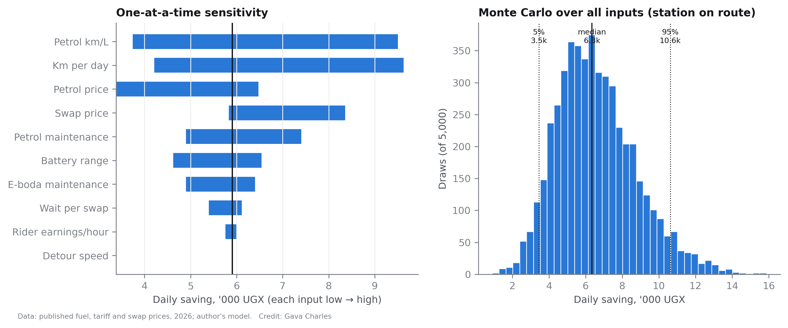
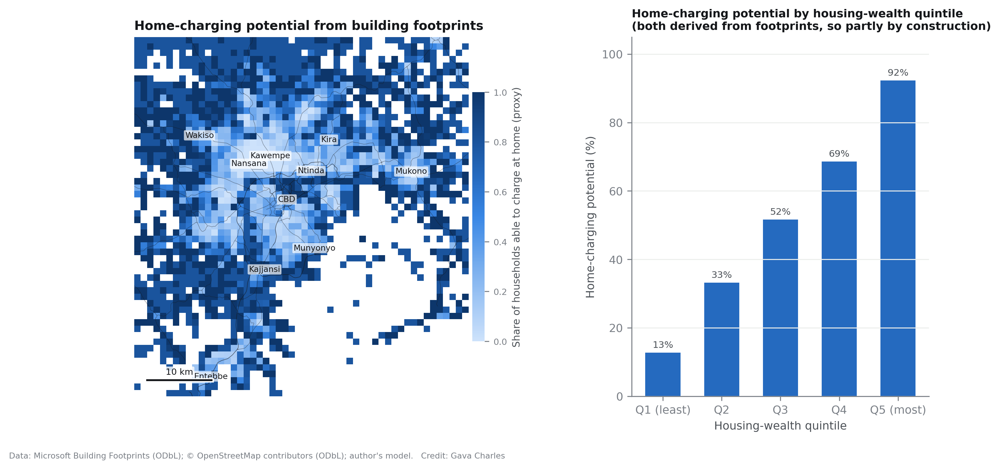
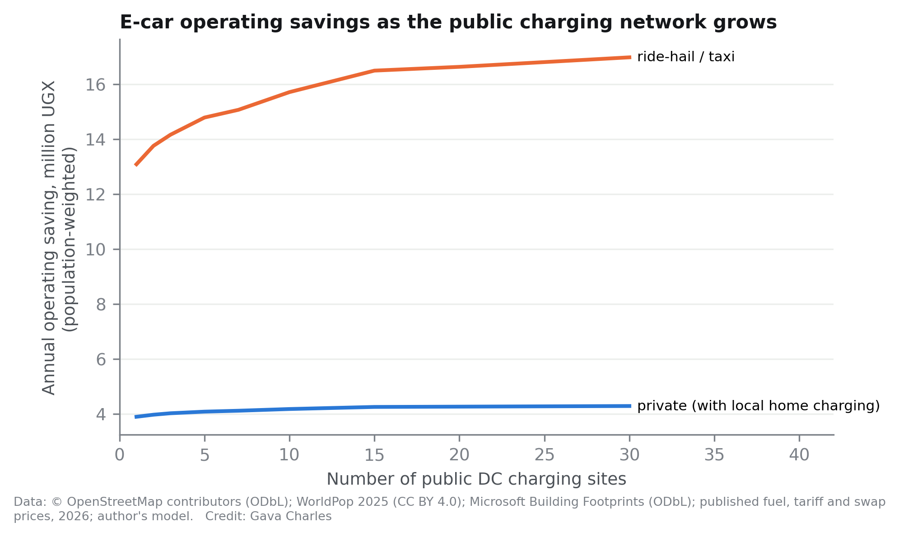

# Network density decides who gains: spatially explicit economics of electric motorcycle taxis and electric cars in Kampala

**Charles Gava**
[Affiliation to be added] · gavacharles85@gmail.com

## Highlights

- A boda rider with a swap station on their route saves about UGX 5,900 a day by going electric; switching is cheaper in all 5,000 simulated input combinations.
- Across the city, swap-network size, not vehicle technology, sets realised savings: from UGX 2,000 a day with 10 sites to 4,500 with 60.
- With 10 sites, peri-urban riders would lose UGX 3,550 a day by switching; with 60 they save 2,200.
- An electric ride-hail car repays a UGX 12 million premium in about 8 months; a private car is a coin flip (52% chance of a positive 5-year NPV).
- Cheap petrol and a thin network together can erase the case for e-bodas: at UGX 5,000/L and 10 sites the average rider loses money.

## Abstract

Electric vehicles are usually evaluated with a single representative user, but their economics depend on where users live and how far they must travel to energy infrastructure. This paper couples rider and driver cost models to a road-network model of proposed battery-swap and fast-charging networks for Greater Kampala, Uganda, to estimate who gains from electrification and when. For motorcycle taxis (boda-bodas), a daily running-cost model with detour and queueing costs, informed by 2026 fuel and swap prices, gives a base-case saving of UGX 5,903 per rider-day when a station is on the route; a Monte Carlo over all ten inputs finds switching cheaper in 100% of 5,000 draws (90% interval UGX 3,452–10,617). Applied spatially, however, realised savings depend strongly on network density: the population-weighted saving rises from UGX 2,029 with 10 swap sites to 3,849 with 30 and 4,489 with 60, as the mean road distance to a station falls from 10.0 to 3.7 km. With 10 sites, riders more than 20 km from the centre would lose UGX 3,552 a day. Petrol prices interact with density: at UGX 5,000/L and 10 sites, the average rider loses money. For electric cars, a five-year net-present-value model with Uganda's 2026 electricity tariffs shows that high-mileage ride-hail cars repay a UGX 12 million premium in about 8 months (positive NPV in 96% of draws), while private cars are marginal (52%), decided mainly by the purchase premium and the fuel economy of the petrol car replaced; home charging, worth UGX 1.6 million a year to a private owner, is concentrated in the wealthiest neighbourhoods. Policy should therefore prioritise network densification in the periphery and commercial vehicle fleets before private cars.

**Keywords:** electric motorcycle taxis; battery swapping; electric vehicles; total cost of ownership; spatial equity; energy access; Uganda

---

## 1. Introduction

Battery-swapping electric motorcycles are spreading quickly through East Africa's motorcycle-taxi sector. In Uganda the swap network more than doubled, from about 150 stations in mid-2024 to over 350 by late 2025 (World Bank, 2026), and Greater Kampala alone has over 400,000 motorcycles. The economic case is usually made with a single number: a rider who switches saves a fixed amount per day. Operators report savings of USD 2–3 per day, and techno-economic studies report lower ownership costs (La Fleur et al., 2024; Kimuli et al., 2026).

That framing leaves out geography. A rider must reach a swap station, often several times a day, and every kilometre ridden empty to a station costs energy and lost fares. Whether a rider in Kira or Kajjansi gains as much as one in Kisenyi depends on the network around them. For electric cars, which in Uganda are at the very first stage of adoption (17 fully electric cars imported in 2022–April 2024; The Observer, 2024), the economics depend on mileage, on whether a household can charge at home, and on the purchase premium created by a 25% import duty on fully built vehicles (The EastAfrican, 2024; allAfrica, 2025).

This paper asks: **how do the economics of electrifying motorcycle taxis and cars vary across Greater Kampala, and what network size, fuel price and vehicle use make electrification pay, and for whom?** It makes three contributions. First, it couples transparent rider and driver cost models to road distances from every populated 1 km cell to proposed swap and charging networks, turning a single representative saving into a spatial distribution. Second, it propagates input uncertainty with Monte Carlo and one-at-a-time sensitivity for both modes. Third, it reports how savings are distributed across wealth quintiles and distance from the centre, and how petrol prices and network size interact.

The networks themselves are taken from a companion paper that sites 60 swap stations and 30 fast chargers on an open-data road graph (Gava, 2026, Paper 1). All code, data and an interactive atlas are public.

## 2. Background

Studies of motorcycle-taxi electrification in East Africa report lower life-cycle emissions (Vanatta et al., 2022) and lower use-phase costs (La Fleur et al., 2024), with financing schemes raising total costs through daily payments. Martin et al. (2023) review the business models emerging across East African capitals. Kimuli et al. (2026) combine GPS duty cycles, hub optimisation and feeder power-flow for Kampala and find that hybrid swap–charge configurations lower ownership costs by 18–27%. These studies treat the rider's access to energy as given.

In the electric-car literature, the spatial distribution of charging access is a well-established equity concern: in the United States, lower-income communities are less well served by public chargers (Carlton and Sultana, 2024; Jiao et al., 2024). Home charging, which requires off-street parking and a dedicated supply, is typically the cheapest option and is unevenly distributed. In African cities, where e-car fleets are small and swap networks for two-wheelers are growing fastest, the interaction between infrastructure geography and user economics has not, to our knowledge, been quantified.

## 3. Methods

### 3.1 Study area, demand and networks

Greater Kampala is divided into a 1 km grid; 1,968 populated cells hold 6.45 million residents (WorldPop, 2025). A swap network of up to 60 sites and a fast-charging network of up to 30 sites are sited greedily by maximal coverage of population weighted by e-boda and e-car suitability on a 15,868 km road graph (Paper 1). For each cell and each network size *N*, we compute the road distance to the nearest of the first *N* sites. Cells are grouped by distance from the CBD (core < 5 km, inner 5–10 km, outer 10–20 km, peri-urban > 20 km) and by housing-wealth quintile, derived from open space per building and median home size in Microsoft building footprints.

### 3.2 Motorcycle-taxi rider model

Daily running cost for a petrol boda is fuel (daily km ÷ km per litre × petrol price) plus maintenance. For an e-boda on pay-per-charge swapping (Spiro charges UGX 84 per percentage point of charge, so a partial swap is billed pro rata), cost is energy for the kilometres ridden, including detours to a station, plus lost earnings during detours and queueing, plus maintenance:

- swaps per day = daily km ÷ km per pack
- detour km per day = swaps × 2 × road distance to the nearest station
- energy cost = (daily km + detour km) × swap price ÷ km per pack
- time cost = swaps × (detour km per swap ÷ detour speed + wait per swap) × hourly earnings

Table 1 lists inputs, ranges and sources. Daily distance (65 km) combines about 18 trips a day with a 3 km mean trip length (Transitec and Transport for Cairo, 2020) plus empty running; no Kampala GPS measure of daily distance was available to us.

**Table 1. Motorcycle-taxi model inputs.**

| Input | Base | Range | Source |
|---|---|---|---|
| Petrol price, UGX/L | 6,650 | 5,100–7,000 | Daily Monitor market surveillance, Kampala, 8 Sep 2026; 2026 reporting |
| Petrol boda economy, km/L | 40 | 30–50 | Assumption: 125–150 cc in urban traffic |
| Distance per day, km | 65 | 40–120 | ~18 trips × ~3 km (Transitec and Transport for Cairo, 2020) plus empty running |
| Swap price per full pack, UGX | 8,400 | 5,000–8,500 | Spiro UGX 84 per % (2026); Gogo ~5,000 and Zembo ~6,000 (2024) |
| Km per full pack | 90 | 75–100 | Operator quotes ~100 km; riders report ~85 km |
| Petrol maintenance, UGX/day | 2,500 | 1,500–4,000 | Assumption |
| E-boda maintenance, UGX/day | 1,000 | 500–2,000 | Assumption |
| Rider earnings, UGX/hour | 3,500 | 2,500–5,000 | Assumption (~35,000 net per 10-hour day) |
| Wait per swap, minutes | 8 | 3–20 | Assumption |
| Detour speed, km/h | 20 | 15–25 | Assumption |

### 3.3 Electric-car model

We compare a used imported battery-electric car with a comparable used petrol car over a five-year holding period, for two uses: a **private** car (40 km/day, 300 days, 80% home charging by default) and a **ride-hail or taxi** car (180 km/day, 310 days, 30% home charging, time valued at lost fares). Annual running cost covers fuel or electricity (home at UGX 779.4/kWh, the 2026 domestic tariff above the lifeline band; public DC at an assumed UGX 1,500/kWh), maintenance, a battery reserve for a used imported pack, and the time and energy cost of detours to public chargers. The net present value of switching is the discounted running-cost saving (15% discount rate) minus the purchase premium (UGX 12 million base, 0–30 million range, reflecting the 25% import duty on fully built EVs). Table 2 lists inputs. Private-car home-charging share varies by cell with the building-footprint home-charging proxy.

**Table 2. Electric-car model inputs.**

| Input | Base | Range | Source |
|---|---|---|---|
| Petrol car economy, km/L | 12 | 9–16 | Assumption: used 1.3–1.8 L import |
| EV consumption, kWh/km | 0.17 | 0.14–0.22 | Leaf-class consumption incl. ~10% charging losses |
| Home tariff, UGX/kWh | 779.4 | 562–950 | UEDCL domestic tariff above lifeline, Oct–Dec 2026 (Daily Monitor) |
| Public DC price, UGX/kWh | 1,500 | 1,000–2,500 | Assumption: no published Kampala price |
| Petrol / EV maintenance, UGX/km | 150 / 70 | 100–250 / 40–120 | Assumption |
| Battery reserve, UGX/km | 60 | 0–150 | Assumption: degradation of a used pack |
| Km per DC session | 150 | 110–200 | Used 40 kWh-class car, 20–80% charge |
| Minutes per DC session | 40 | 25–70 | Assumption |
| EV purchase premium, UGX | 12 million | 0–30 million | Assumption: landed price gap with 25% import duty |
| Discount rate | 15% | 10–22% | Assumption |
| Holding period, years | 5 | 3–7 | Assumption |

### 3.4 Uncertainty and scenarios

Monte Carlo draws (5,000) sample every input from a triangular distribution over its range. One-at-a-time sensitivity moves each input to its bounds. Spatial scenarios cross three petrol prices (UGX 5,000, 6,650, 8,000/L) with three swap-network sizes (10, 30, 60). All results are population-weighted.

## 4. Results

### 4.1 With a station on the route, an e-boda always pays

At base values, a petrol boda costs UGX 13,306 a day to run and an e-boda UGX 7,404, a saving of UGX 5,903 (about USD 1.6), in line with operator claims of USD 2–3. Across 5,000 draws the saving is positive every time (median UGX 6,345; 90% interval 3,452–10,617; Figure 9). The petrol bike's fuel economy, daily distance, the petrol price and the swap price dominate the uncertainty. Electric stays cheaper down to a petrol price of about UGX 3,020/L, and a rider can detour up to 15 km each way before the saving disappears.

### 4.2 Across the city, network density sets the saving

Few riders have a station on their route. Measured from where people live, the population-weighted saving is UGX 2,029 a day with 10 swap sites, 3,849 with 30 and 4,489 with 60, as the mean road distance to the nearest station falls from 10.0 km to 5.3 km and 3.7 km (Table 3). The first 30 sites capture most of the gain.

**Table 3. Access and rider saving by swap-network size (population-weighted).**

| Sites | Mean road distance to station | Residents within 2.5 km | Daily saving per rider |
|---|---|---|---|
| 1 | 14.8 km | 3% | UGX 156 |
| 10 | 10.0 km | 22% | UGX 2,029 |
| 20 | 7.3 km | 36% | UGX 3,084 |
| 30 | 5.3 km | 46% | UGX 3,849 |
| 60 | 3.7 km | 65% | UGX 4,489 |

The gradient from centre to edge is steep (Figure 7). Riders within 5 km of the CBD save over UGX 5,100 a day at every network size. In the outer ring (10–20 km) the saving rises from UGX 1,618 with 10 sites to 4,759 with 60. In the peri-urban ring (> 20 km), riders would **lose** UGX 3,552 a day with 10 sites; they gain UGX 594 with 30 and 2,201 with 60. The outer and peri-urban rings hold 3.5 million people and absorb 55% of the city's population growth.

Across wealth quintiles the pattern reverses the usual equity concern: with 30 sites, riders in the least-wealthy quintile save UGX 4,468 a day and those in the wealthiest UGX 3,982, because swap demand and the first sites are concentrated in dense, lower-income inner neighbourhoods.

### 4.3 Petrol prices and network density interact

Electrification is most fragile where cheap petrol meets a thin network (Figure 10, Table 4). At UGX 5,000/L and 10 sites, the population-weighted rider loses UGX 652 a day, and no one is in a cell where the saving exceeds UGX 3,000. At the September 2026 price of about UGX 6,650/L, 52% of residents live where the saving exceeds UGX 3,000 with 10 sites, rising to 79% with 30 and 88% with 60. A petrol price of UGX 8,000/L would push savings above UGX 6,000 with 30 sites.

**Table 4. Population-weighted daily rider saving (UGX) by petrol price and network size.**

| Petrol price | 10 sites | 30 sites | 60 sites |
|---|---|---|---|
| UGX 5,000/L | −652 | 1,168 | 1,808 |
| UGX 6,650/L | 2,029 | 3,849 | 4,489 |
| UGX 8,000/L | 4,223 | 6,043 | 6,683 |

### 4.4 Electric cars: fleets first, private cars later

Running costs favour electric cars for both uses: UGX 8.45 million against 3.48 million a year for a private car, and UGX 39.3 million against 20.8 million for a ride-hail car. Once the purchase premium is included, the two uses diverge sharply (Figure 13). A ride-hail car repays a UGX 12 million premium in about 8 months; its five-year NPV is UGX 49.9 million at base values, positive in 96% of draws (90% interval 2.5–67.2 million), and it can absorb a premium of up to UGX 61.9 million. A private car takes 2.4 years to repay the same premium; its NPV is UGX 4.7 million at base values but positive in only 52% of draws (90% interval −12.3 to +12.0 million), with a break-even premium of UGX 16.7 million.

What decides the outcome differs by use. For private cars, the purchase premium dominates, followed by the petrol car's fuel economy, the holding period and the petrol price. For ride-hail cars, the petrol car's economy, the holding period, the public fast-charging price and the premium matter most. Home charging is worth UGX 1.6 million a year to a private owner: the saving rises from 3.67 million with no home charging to 5.30 million with all charging at home.

### 4.5 Who can charge at home, and how much public chargers add

Home-charging potential, estimated from open space around buildings, averages 46% of households (population-weighted) and rises from 13% in the least-wealthy quintile to 92% in the wealthiest (Figure 12). This gradient is partly built in, because the wealth and home-charging proxies use the same footprint measure; it nonetheless indicates that private e-car economics will favour already-advantaged households.

Public fast charging matters most for fleets. As the network grows from 1 to 10 sites, the population-weighted ride-hail saving rises from UGX 13.1 million to 15.7 million a year, and to 17.0 million with 30 sites (Figure 15); private-car savings move far less (UGX 3.9 to 4.3 million), because most private charging is at home.

## 5. Discussion

**The saving is a property of the network, not just the vehicle.** The headline saving of an e-boda is real but only fully available to riders who work near a station. Across the city as it is, a modest network halves it on average and reverses it at the edge. Swap operators expanding from the centre outward will find their early peri-urban customers economically marginal unless sites are added there in clusters.

**Peri-urban densification is where public support has most leverage.** Inner-city riders gain at any network size; peri-urban riders move from losing money to gaining over UGX 2,000 a day as the network grows from 10 to 60 sites. Public support for station siting (land at markets and forecourts, grid connections, viability-gap funding) would do most where commercial networks arrive last and where 55% of new residents are settling.

**Fuel taxation and network policy work together.** The UGX 200/L fuel excise increase in Uganda's 2026/27 budget (Daily Monitor, 2026c) moves petrol prices in the direction that favours electrification. Our results show that the same price change matters far more where the network is thin: the gap between 10 and 30 sites is worth more to riders than a UGX 1,500/L swing in petrol prices at the city edge.

**For cars, start with fleets.** Ride-hail and taxi cars cover four to five times the distance of private cars and pay back within a year even with a UGX 12 million premium. Private cars are marginal and depend on home charging that mostly the wealthiest households have. The planned public fast-charging network (Paper 1) and any import-duty relief would yield the largest return if targeted first at commercial fleets.

**Grid implications follow from the economics.** The demand that makes e-bodas pay concentrates load: a 60-site network serving 25% of Kampala's motorcycles would need about 17.5 MW at peak, within the 60–99 MW national EV peak range projected by the World Bank (2026). Smart charging and denser networks spread that load.

## 6. Limitations

Several inputs are assumptions (maintenance, earnings, waiting time, public DC price, EV purchase premium) and are flagged as such; the Monte Carlo bounds their influence but cannot substitute for rider and driver surveys. Daily distance is inferred rather than measured. Riders are assigned to stations by residence, whereas they work across the city; using operating areas from GPS data would sharpen the spatial estimates. Financing costs, which La Fleur et al. (2024) show raise total cost, and battery-as-a-service contracts are not modelled. The car model uses a used imported vehicle and does not consider new EVs or hybrids. Network geometry comes from an open-data siting model, not from actual operator networks.

## 7. Conclusion

Electric motorcycle taxis already pay for riders who can reach a swap station, and electric ride-hail cars pay back within a year. What determines whether these gains reach most people in Greater Kampala is the density and reach of the energy network. With 10 swap sites, the average resident's rider would gain a third of the headline saving and peri-urban riders would lose money; with 60, most riders gain most of it. Policies that densify networks in the periphery, keep pressure on petrol prices and prioritise commercial car fleets would spread the benefits of electrification most widely.

## Data and code availability

Code, derived data, figures and the interactive atlas: https://github.com/gavacharles/kampala-emobility-atlas and https://gavacharles.github.io/kampala-emobility-atlas/. Model inputs and their sources are in `emobility/economics.py` and `emobility/car_economics.py`.

## CRediT authorship contribution statement

Charles Gava: Conceptualization, Methodology, Software, Formal analysis, Visualization, Writing – original draft, Writing – review & editing.

## Declaration of competing interest

The author declares no competing interests.

## Funding

[To be completed.]

## References

allAfrica, 2025. Uganda deploys 10-year tax holiday, national strategy to become "net source" of e-mobility. 6 November 2025. https://allafrica.com/stories/202511060049.html

Carlton, G.J., Sultana, S., 2024. Electric vehicle charging equity and accessibility: a comprehensive United States policy analysis. Transportation Research Part D 129, 104123. https://doi.org/10.1016/j.trd.2024.104123

Daily Monitor, 2026a. Market surveillance of fuel prices, Kampala, 8 September 2026 (reported in "We have no control over fuel prices – Dr Musenero"). https://www.monitor.co.ug/uganda/news/national/we-have-no-control-over-fuel-prices-dr-musenero-5623882

Daily Monitor, 2026b. UEDCL sets new power tariffs for final quarter. https://www.monitor.co.ug/uganda/news/national/uedcl-sets-new-power-tariffs-for-final-quarter-5620680

Daily Monitor, 2026c. Independent, at what cost though? (column on the 2026/27 fuel excise). https://www.monitor.co.ug/uganda/lifestyle/reviews-profiles/independent-at-what-cost-though--5623738

Gava, C., 2026. Where to swap and where to charge: an open-data, road-network framework for siting electric motorcycle-taxi battery swapping and electric-car fast charging in Greater Kampala. Manuscript (Paper 1).

Jiao, J., Choi, S.J., Nguyen, C., 2024. Toward an equitable transportation electrification plan: measuring public electric vehicle charging station access disparities in Austin, Texas. PLOS ONE 19(9), e0309302. https://doi.org/10.1371/journal.pone.0309302

Kimuli, I., Kirabira, J.B., Nakyejwe, S.L.K., 2026. Electrifying boda-boda transportation with battery-swapping: a techno-economic and grid-aware rollout for Kampala Metropolis. Energy Conversion and Management: X 30, 101648. https://doi.org/10.1016/j.ecmx.2026.101648

La Fleur, L., Lindkvist, E., Trångteg, R., Winter, S., Thollander, P., 2024. Riding the future: environmental, primary energy and economic analysis of an electric motorcycle – a Kenyan case study. Energy for Sustainable Development 83, 101573. https://doi.org/10.1016/j.esd.2024.101573

Martin, E., Courtright, T., Nkurunziza, A., Lah, O., 2023. Motorcycle taxis in transition? Review of digitalization and electrification trends in selected East African capital cities. Case Studies on Transport Policy 13, 101057. https://doi.org/10.1016/j.cstp.2023.101057

PC Tech Magazine, 2024. Battery swapping, costs involved on an electric motorcycle. https://pctechmag.com/2024/07/battery-swapping-costs-involved-on-an-electric-motorcycle/

The EastAfrican, 2024. Uganda reinstates tax on e-vehicles. https://theeastafrican.co.ke/tea/business/uganda-reinstates-tax-on-e-vehicles-4673578

The Observer, 2024. Uganda's transition towards e-mobility takes promising shape (URA import data 2022–April 2024). https://observer.ug/news/uganda-accelerates-transition-to-electric-vehicles/

Transitec, Transport for Cairo, 2020. Analysis of boda-boda operations: paratransit modernization and street usage study, final report. Agence Française de Développement and Kampala Capital City Authority, July 2020. https://transportforcairo.com/wp-content/uploads/2024/12/17_3_BBSP_Final_Report_v1.3.pdf

Vanatta, M., Rathod, B., Calzavara, J., Courtright, T., Sims, T., Saint-Sernin, É., Clack, H., Jagger, P., 2022. Emissions impacts of electrifying motorcycle taxis in Kampala, Uganda. Transportation Research Part D 104, 103193. https://doi.org/10.1016/j.trd.2022.103193

World Bank, 2026. The battery under the seat: how Uganda is gearing up for electric mobility at scale. Feature story, 21 September 2026. https://www.worldbank.org/en/news/feature/2026/09/21/the-battery-under-the-seat-how-uganda-is-gearing-up-for-electric-mobility-at-scale

WorldPop: Tatem, A.J., 2017. WorldPop, open data for spatial demography. Scientific Data 4, 170004. https://doi.org/10.1038/sdata.2017.4
